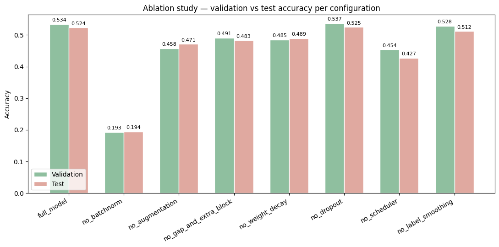
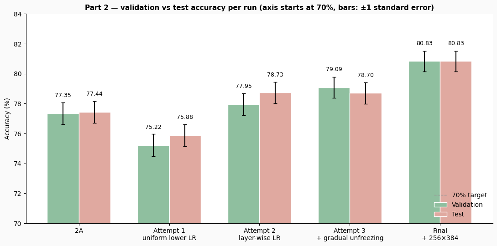

# Fine-Grained Aircraft Classification (FGVC-Aircraft)

Classifying photos of **100 aircraft variants** (e.g. Boeing 737-300 vs 737-400) from the
[FGVC-Aircraft](https://www.robots.ox.ac.uk/~vgg/data/fgvc-aircraft/) dataset, with only
**about 33 training images per class**.

Developed by **Francesca Lonardo** for the Image Processing and Computer Vision course
(M.Sc. in Artificial Intelligence, University of Bologna). The assignment text is by
[CVLAB-Unibo](https://github.com/CVLAB-Unibo/ipcv-assignment-2).

## Results

| Part | Model | Test accuracy | Target |
|---|---|---|---|
| 1 | CNN designed and trained **from scratch** | **52.36%** | ~50% |
| 2A | ResNet-18 (ImageNet) fine-tuned with Part 1's hyperparameters | 77.44% | ~70% |
| 2B | ResNet-18 with layer-wise learning rates, gradual unfreezing, 256×384 input | **80.83%** | — |

All design choices were made on the validation split; the test split was evaluated only once
per configuration.

## Part 1: a CNN from scratch, with an ablation study

The network was built incrementally from a minimal 4-block baseline, adding one component at a
time. The final model has five `Conv–BatchNorm–ReLU` blocks (32 → 512 channels) with
max-pooling, Global Average Pooling and Dropout, and is trained with Adam, a OneCycle
learning-rate schedule, weight decay, label smoothing and data augmentation. Images are cropped
to remove the copyright banner and resized to 112×160 to keep their aspect ratio.

An **ablation study** then removes one component at a time and retrains from scratch:

- **Batch Normalization** is essential (−34 points on validation): without it the network
  barely learns the training set.
- The **scheduler**, **data augmentation**, **weight decay** and **GAP + 5th block** each add
  4–8 points.
- **Dropout** and **label smoothing** have no measurable effect on accuracy, although Dropout
  narrows the train/validation gap by about 10 points.
- The components act in two different ways: some mainly help **optimization** (BatchNorm,
  scheduler, weight decay), others mainly fight **overfitting** (augmentation, GAP, Dropout).

## Part 2: fine-tuning ResNet-18

Reusing Part 1's hyperparameters already reaches 77.4%, but the training curves show an
unstable first half (the learning rate, tuned for random weights, damages the pretrained
features) and strong overfitting. The improvements were tested one at a time:

1. A **uniform lower learning rate** made things worse (75.9%): the upper layers stay too close to ImageNet.
2. **Layer-wise learning rates** (Howard & Ruder, 2018), from `3e-3` for the new classifier
   down to about `1e-4` for the first convolution, recovered the drop (78.7%).
3. **Gradual unfreezing** from the top layer down gave a small gain on validation, within the noise on test.
4. A **higher input resolution** (256×384, keeping the aspect ratio instead of a square crop)
   gave the clearest improvement, up to **80.8%**.

Error bars (±1 standard error of the split) are used throughout to tell real improvements from noise.

## Running the notebook

The notebook was run on **Google Colab** with a GPU.

1. Open [`notebooks/fgvc_aircraft_classification.ipynb`](notebooks/fgvc_aircraft_classification.ipynb) in Colab.
2. The dataset is downloaded automatically through `torchvision.datasets.FGVCAircraft`.
3. Results and model weights are saved to Google Drive (`RESULTS_DIR`), so finished runs are
   reloaded instead of retrained. To run elsewhere, remove the `drive.mount` cell and set
   `RESULTS_DIR` to a local folder.

Dependencies: `torch`, `torchvision`, `torchsummary`, `numpy`, `pandas`, `matplotlib`, `tqdm`
(see [`requirements.txt`](requirements.txt)).
